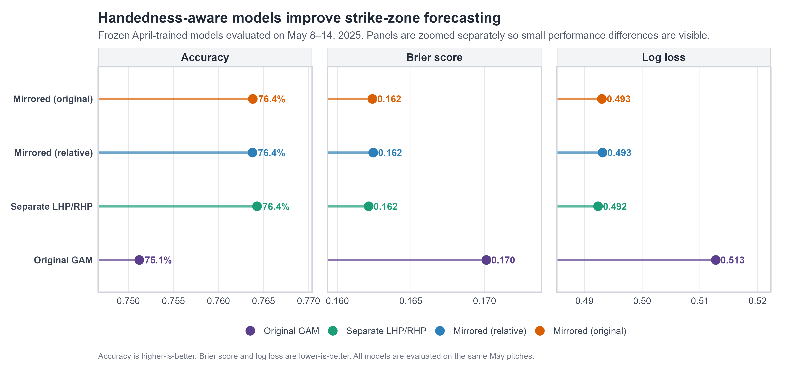
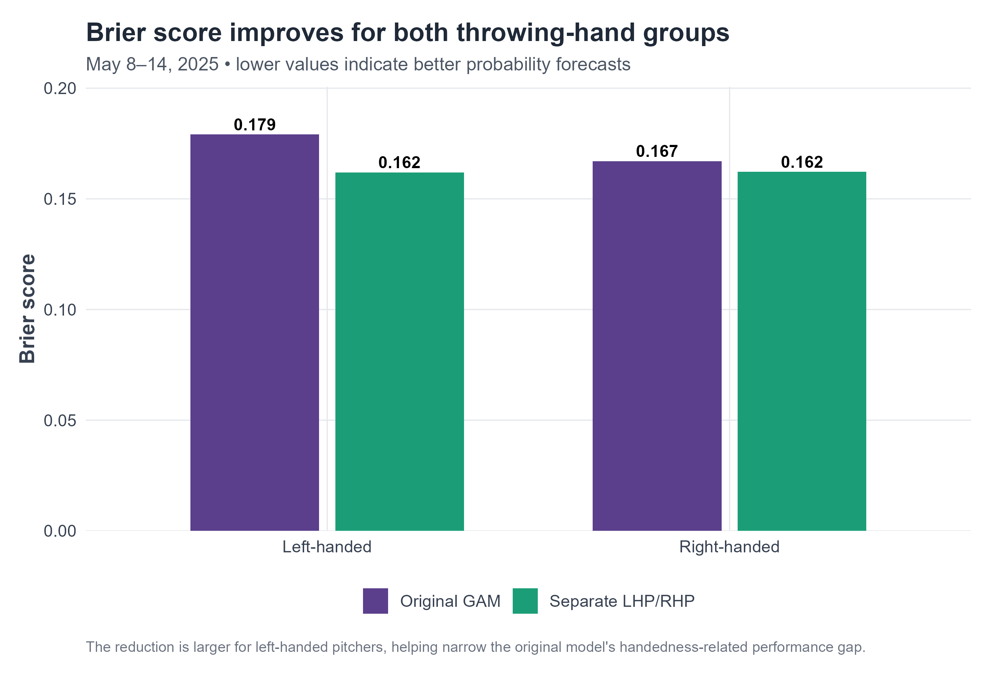
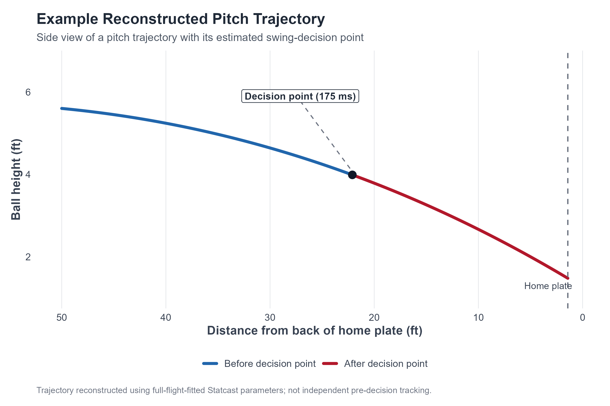
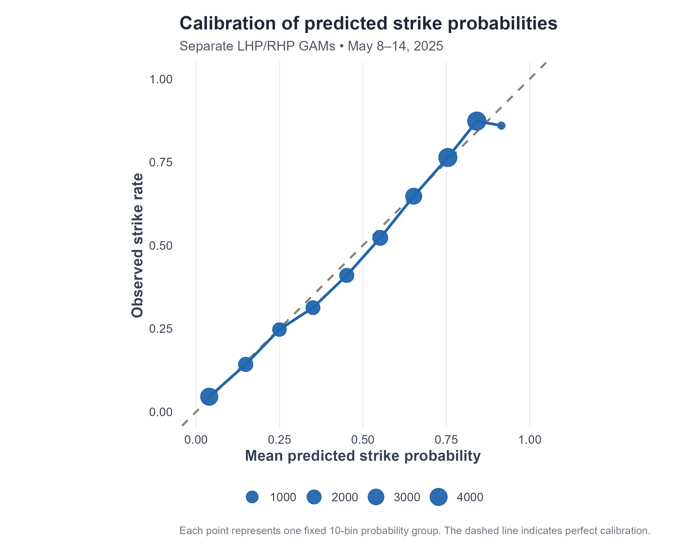
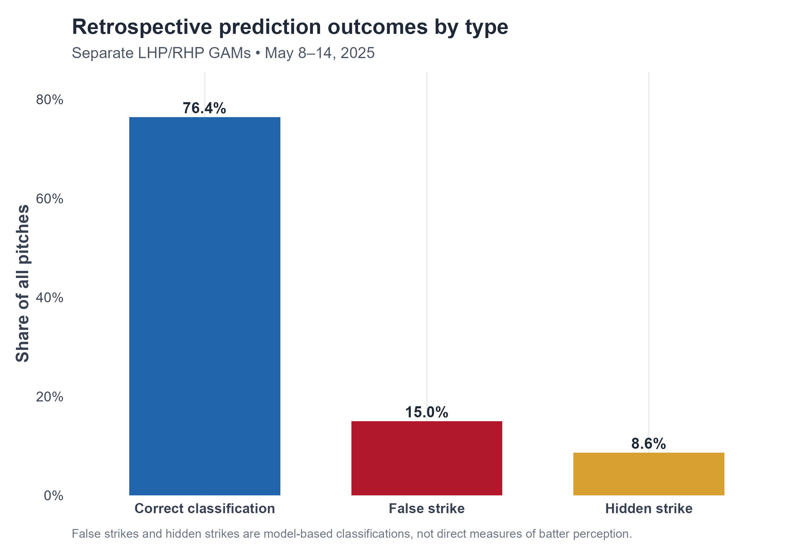
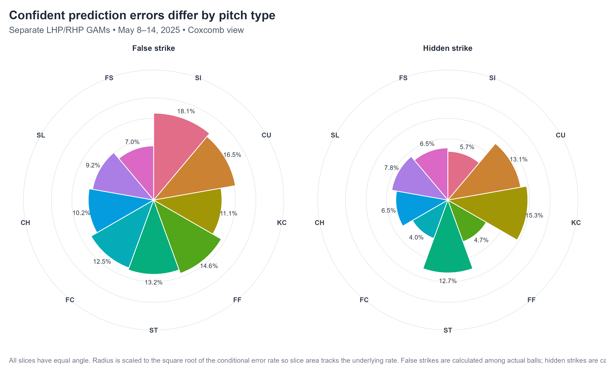
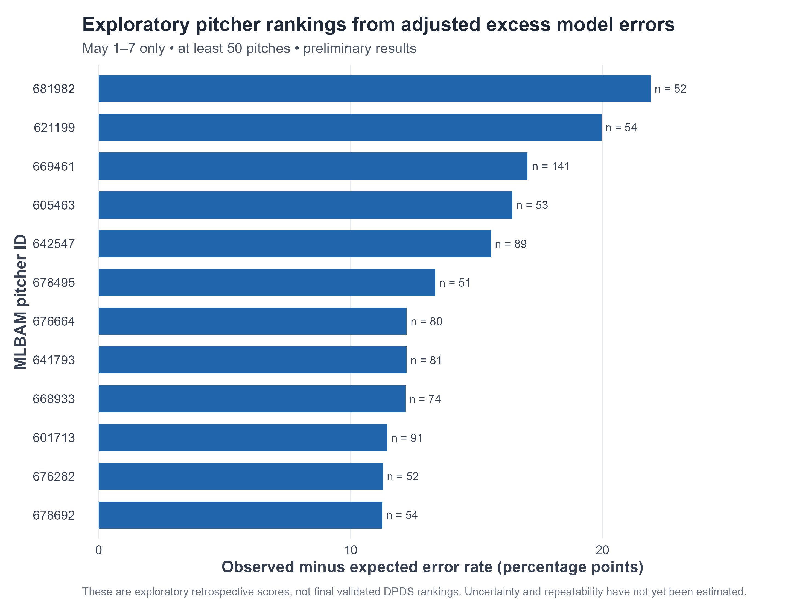

# MLB Pitcher Deception

### Can a pitcher's final location be anticipated at the batter's swing-decision point?

I am investigating how predictable MLB pitches are shortly before they reach home plate, whether that predictability differs across pitchers, and whether unexpected pitch locations are associated with pitching success.

I use **2025 MLB Statcast data**, physics-based trajectory reconstruction, and generalized additive models (GAMs) in **R**. My long-term goal is to develop a validated **Decision-Point Deception Score (DPDS)** that distinguishes pitches that appear likely to finish in the zone but miss it (*false strikes*) from pitches that appear likely to miss but finish in the zone (*hidden strikes*).

> **Project status — active research.** The current results measure errors from **retrospective trajectory-based models**, not batter perception. Statcast's published trajectory coefficients are estimated from the complete flight, so reconstructed decision-point locations may encode information not actually available at the decision point. I am treating the current analysis as a modeling benchmark, not a finished deception metric.

## Key results

The clearest finding so far is that **accounting for pitcher handedness improves strike-zone forecasts**. I trained the models on April 2025 data, explored model designs on May 1–7, and then evaluated the frozen candidates on **May 8–14 (27,706 usable pitches)**.

| Model | Accuracy ↑ | Brier score ↓ | Log loss ↓ |
|:--|--:|--:|--:|
| Original combined GAM | 75.1% | 0.170 | 0.513 |
| **Separate LHP / RHP GAMs** | **76.4%** | **0.162** | **0.492** |
| Mirrored X, original handedness | 76.4% | 0.162 | 0.493 |
| Mirrored X, relative handedness | 76.4% | 0.162 | 0.493 |

The separate-handedness models improved accuracy by **1.3 percentage points** over the original GAM in this follow-up week. The mirrored models performed nearly as well. Differences among the handedness-aware candidates are small and have not been established as statistically significant.



*Figure 1. Four April-trained GAM specifications evaluated on the same May 8–14 pitches. Each panel uses its own scale to make small model differences visible; higher accuracy is better, while lower Brier score and log loss are better.*

### Why handedness matters

The original combined GAM performed worse for left-handed pitchers. On May 8–14, the separate GAMs improved the LHP Brier score from **0.179 to 0.162** and the RHP Brier score from **0.167 to 0.162**. This suggests that some of the earlier difference in model errors by throwing hand was due to how the model represented trajectories rather than a demonstrated difference in deception.



*Figure 2. Model performance by pitcher throwing hand on May 8–14. Lower Brier scores indicate more accurate probabilistic predictions.*

## How the analysis works

### 1. Reconstruct pitch flight

I download regular-season pitch-level data using [`baseballr`](https://billpetti.github.io/baseballr/) and use Statcast's fitted velocity and acceleration coefficients to reconstruct each pitch's trajectory. The coordinate calculation follows a constant-acceleration representation:

```text
x(t) = x0 + vx0*t + 0.5*ax*t²
z(t) = z0 + vz0*t + 0.5*az*t²
```

The model aligns release coordinates to the **50-foot reference plane** before calculating the ball's position. I estimate a decision point **175 milliseconds before plate crossing** and have explored 150 ms and 200 ms alternatives. The reconstructed plate positions match Statcast's reported locations very closely (approximately **0.0025 ft mean absolute error per axis**), which checks the reconstruction arithmetic—not the independence of the original tracking data.



*Figure 3. Example reconstructed pitch in side view. The colored segments distinguish flight before and after the assumed decision point. This is a reconstruction of a full-flight fit, not a set of independently observed pre-decision positions.*

### 2. Define the strike-zone outcome

I calculate a geometric strike-zone label (`strike_overlap`) using the pitch's recorded plate-crossing coordinates, pitch-specific `sz_top` and `sz_bot`, the plate's **8.5-inch half-width**, and a **1.45-inch ball radius**. A pitch is labeled a strike if any part of the modeled ball overlaps the zone. I retain a stricter ball-center label for sensitivity analyses. These labels describe geometry, not an umpire's call.

### 3. Predict whether the pitch finishes in the zone

I began with a constant strike-probability model and a logistic regression using pre-pitch context. I then trained a GAM using count, batter and pitcher handedness, and the reconstructed three-dimensional decision-point location.

The GAM uses smooth terms to model nonlinear relationships between position and the probability of a strike. After observing differences by throwing hand, I compared:

- A single combined GAM.
- Separate GAMs for left-handed and right-handed pitchers.
- A combined GAM with left-handed horizontal decision-point coordinates mirrored into a common orientation, using two handedness representations.

I evaluate **classification accuracy**, **Brier score**, **log loss**, and probability calibration, with chronological separation between model training and later evaluation dates.



*Figure 4. Calibration of the selected available model predictions on the plotted May evaluation period. The dashed diagonal represents perfect calibration.*

### 4. Examine unexpected outcomes

I distinguish two kinds of incorrect strike-zone forecasts:

| Error type | Prediction | Actual location |
|:--|:--|:--|
| **False strike** | Inside the zone | Outside the zone |
| **Hidden strike** | Outside the zone | Inside the zone |

The basic classification uses a **0.50** probability threshold. A more restrictive exploratory analysis counts *confident* false strikes when the model predicts a strike probability of at least **0.70**, and *confident* hidden strikes when it predicts at most **0.30**.



*Figure 5. Distribution of prediction outcomes. These are model errors and should not be interpreted as directly observed visual deception.*

The frequency of confident errors also varies by pitch type. To avoid confusing different base rates, I calculate false-strike rates among **actual balls** and hidden-strike rates among **actual strikes**.



*Figure 6. Conditional error rates by pitch type, displayed as two coxcomb charts. The wedge areas represent rates rather than pitch counts; only pitch types meeting the script's sample thresholds are included.*

### 5. Explore pitcher-level differences

I began an observed-versus-expected adjustment to account for characteristics such as pitch type, velocity, movement, count, and handedness. A positive value means a pitcher produced more confident forecast errors than expected under the adjustment model.



*Figure 7. Exploratory pitcher rankings from the earlier May 1–7 adjustment analysis. These values use the original combined GAM, have limited game-level samples, and are **not** validated DPDS rankings.*

This is a diagnostic rather than a finished leaderboard: the sample is small, the scores depend on the forecasting model, and uncertainty and repeatability have not yet been established.

## Data and reproducibility

### Data windows

| Period | Purpose | Usable pitches |
|:--|:--|--:|
| April 2025 | Model development and April validation | 108,400 complete trajectory records across the month |
| May 1–7, 2025 | Initial evaluation and handedness-model exploration | 27,640 |
| May 8–14, 2025 | Frozen-model chronological follow-up | 27,706 |

The April model-fitting, tuning, and development-evaluation dates are separated within the month. See the training scripts for those boundaries. I download May data by individual day to avoid truncated multi-day responses, and I check for duplicate pitch identifiers.

### Repository layout

```text
MLB-Pitcher-Deception/
├── README.md
├── RUN_ORDER.md
├── CODE_REVIEW.md
├── .gitignore
├── scripts/
│   ├── 01_data_collection.R
│   ├── 02_trajectory_reconstruction.R
│   ├── 03_strike_zone.R
│   ├── 04_deception_model.R
│   ├── 05_expand_statcast.R
│   ├── 06_may_validation.R
│   ├── 07_verify_may_download.R
│   ├── 08_may_evaluation.R
│   ├── 09_pitch_mix_adjustment.R
│   ├── 10_expand_may.R
│   ├── 11_handedness_models.R
│   ├── 12_handedness_validation.R
│   └── 13_generate_figures.R
├── figures/                 # Committed PNG and PDF figures
├── data/                    # Local Statcast data; not committed
└── models/                  # Local trained objects; not committed
```

### Run the analysis

I use **R / RStudio** with the packages `baseballr`, `tidyverse`, `mgcv`, and `scales`.

```r
install.packages(c("baseballr", "tidyverse", "mgcv", "scales"))
```

Once the raw data files have been downloaded and verified using the acquisition scripts, run the analysis **from the repository root**, in the order below:

```r
source("scripts/01_data_collection.R")
source("scripts/02_trajectory_reconstruction.R")
source("scripts/03_strike_zone.R")
source("scripts/04_deception_model.R")
source("scripts/08_may_evaluation.R")
source("scripts/09_pitch_mix_adjustment.R")
source("scripts/11_handedness_models.R")
source("scripts/12_handedness_validation.R")
source("scripts/13_generate_figures.R")
```

For first-time data acquisition, additional setup, and script dependencies, see **[RUN_ORDER.md](RUN_ORDER.md)**. The plotting script generates both PNG and PDF versions. Raw Statcast downloads and trained objects are intentionally excluded from version control; scripts currently exchange some objects through the R session, so follow the documented execution order.

## Limitations and next steps

**The most important limitation is information leakage from full-flight tracking fits.** Although I calculate positions 175 ms before the plate, the underlying Statcast coefficients were estimated using the full pitch trajectory. This means my current models cannot establish what a batter could have predicted at that instant. Generating synthetic early-flight positions from the same coefficients would not solve this problem.

Other limitations include the assumed fixed decision time, geometric approximations to the strike zone, uneven pitcher sample sizes, model-specific prediction errors, and exploratory model selection on May 1–7. The May 8–14 check strengthens the handedness-model comparison, but does not settle uncertainty, stability across the season, or causal effects on hitters.

My next priorities are to:

1. Find reliable, time-stamped ball-position observations available **only up to the decision point** and validate their spatial accuracy.
2. Fit early-flight-only trajectory forecasts and compare them with the current retrospective GAM benchmarks.
3. Test decision-point timing and strike-zone-definition sensitivity.
4. Estimate pitcher-level uncertainty and repeatability using larger samples and game-aware methods.
5. Evaluate whether a validated deception metric adds information beyond conventional pitch characteristics when studying chase and whiff outcomes.

**The central question remains open:** which pitchers make their pitches' final locations hardest to anticipate at the batter's decision point—and does that unpredictability contribute to pitching success?
